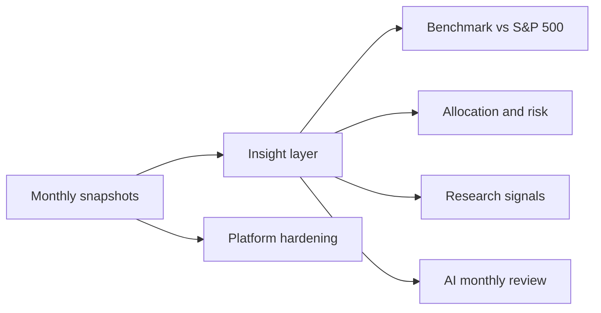

# Portfolio Intelligence Tracker: next-level roadmap

## Where the product stands today

The app is built around **monthly Tickertape CSV snapshots**: Import, History (with CSV export and delete), Dashboard, Compare, Securities with research notes, Tags, My Focus, Planner and Reports with PDF export. Everything is derived from snapshots stored in [prisma/schema.prisma](prisma/schema.prisma) (`PortfolioSnapshot`, `SnapshotHolding`, `SecurityResearch`).

The biggest structural limits:
- **No benchmark.** A return of +1.63% has no context: was the market up 5% or down 3%?
- **Research targets are not used.** `targetPrice`, `stopPrice` and `accumulationMin/Max` in `SecurityResearch` are stored but never checked against `currentPrice`.
- **Sector data is barely used.** `Security.sector` and `industry` exist, but there is no allocation or concentration view.
- **Returns are approximated.** Modified Dietz between snapshots is used; there is no XIRR on dated cash flows.
- **No engineering safety net.** There is no CI, no end-to-end tests, and no backup or restore of user data.

## Theme A: Insight (highest user value, low risk)

1. **Benchmark comparison.** Store monthly closes for the S&P 500 and Nasdaq 100 (a new `BenchmarkPrice` table, seeded from a static CSV first and later from an API). Show "You vs S&P 500" on the Dashboard, the Monthly performance chart and Reports, using the same money-weighted flows so the comparison is fair: what your contributions would be worth in the index.
2. **Allocation and concentration.** Add a new Dashboard and Reports section with allocation by sector, type (stock / ETF) and tag, plus a top-5 concentration %. Warn when one holding is over a set % (configurable in Settings). This uses data that already exists, so no schema change is needed beyond optional sector backfill on the securities mapping page.
3. **Research signals.** Compare each holding's latest `currentPrice` to its research `targetPrice`, `stopPrice` and accumulation zone. Show badges in Securities and a "Needs attention" card on the Dashboard: "GRAB is in your buy zone", "TSLA hit target". This is pure logic over existing data.
4. **XIRR (true annualized return).** Treat the Δ invested from each snapshot as a dated cash flow and compute XIRR in `src/lib/portfolio/analytics/`. Show it next to the total return on Dashboard, Planner and Reports.

## Theme B: Intelligence (differentiator)

5. **AI monthly review.** After each import, generate a short narrative: what changed, the biggest movers, concentration drift, and holdings that are off their research thesis. Store it per snapshot and include it in Reports. This would go through Neon AI Gateway (the `neon-ai-gateway` skill is already in the repo), with a strict prompt over computed numbers only, so the AI never invents data.
6. **Thesis check reminders.** Flag holdings whose research note is older than N months, or whose P&L moved more than X% since the thesis was written.

## Theme C: Data in (less manual work)

7. **Live or daily prices.** Fetch daily closes for held tickers so the Dashboard shows a "today" value between monthly snapshots. Snapshots stay the source of truth for quantities and invested amounts. This needs a price provider choice and a cron (Neon Functions trigger or Vercel cron).
8. **More importers.** Make the CSV column mapper broker-agnostic (Vested, INDmoney, IBKR) with saved mapping presets per profile.

## Theme D: Platform and trust

9. **CI pipeline.** Run typecheck, lint, vitest and `next build` on every push (GitHub Actions).
10. **End-to-end tests.** Use Playwright for the critical flows: sign up, import CSV, dashboard renders, delete snapshot, export report.
11. **Account safety.** Add password reset, a session list with "log out everywhere", and a full data export (JSON or ZIP of all snapshots) as a backup.
12. **Household view.** A consolidated dashboard across all profiles of one user (for example, self and spouse).

## Suggested order (impact against effort)

- **Do first:** Research signals (3), Allocation (2) and Benchmark (1). All three use mostly existing data, and each makes every other screen more meaningful.
- **Then:** XIRR (4) and CI (9). Both are small and raise trust in the numbers.
- **Then:** AI monthly review (5). It works best once benchmark and allocation data exist to feed it.
- **Later:** Live prices (7), more importers (8), the household view (12), and account safety (11).

Each picked item will get its own detailed plan before implementation.
